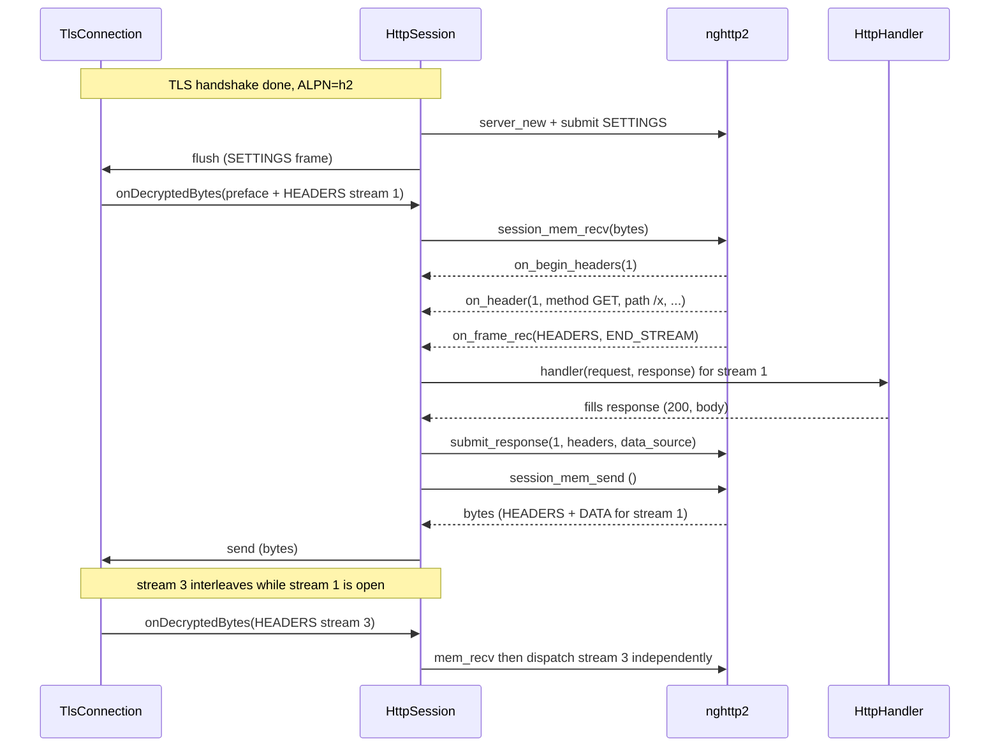

<!-- cox/insights/features/http2-design.md -->
# Design: HTTP/2 (via nghttp2)

> **Status:** SERVER IMPLEMENTED, opt-in via `COX_WITH_HTTP2`
> (default OFF; `cmake --preset http2`). `http::Http2Session`
> (`http/http2_session.*`) is a socket-free nghttp2 server session; `HttpServer`
> switches a TLS connection to it when ALP selects `h2` and the SAME
> `HttpHandler` serves h2 and HTTP/1.1 (`HttpRequest::version()` is `"HTTP/2"`
> on h2). `TlsConnection::negotiatedprotocol()` now forwards ALPN. nghttp2
> comes from the system `libnghttp2` via pkg-config, or from a vendored
> `third_party/nghttp2` submodule if one is checked out (§8). Containment:
> SETTINGS cap concurrent streams (excess refused with REFUSED_STREAM) and the
> header list (431); the server's body limit applies (413); output
> backpressure follows the socket's write-complete. Tests:
> `tests/http2_session_test.cc` (11, socket-free against an nghttp2 client
> session) and `tests/http2_integration_test.cc` (5, real `curl --http2`:
> h2/h1 on one handler, 20 requests multiplexed on ONE connection, large
> response, POST, 413, h1 fallback when the server omits `h2`). ASan/TSan
> clean; GCC Release builds clean.
> 
> CONNECTION LIFECYCLE: every SETTINGS value and limit is
> configurable through `HttpServer::Http20ptions` / `Http2Session::Limits`
> (max concurrent streams, header list size, initial and connection window,
> max frame size, max stream ID, max requests per connection), validated
> against RC 9113 bounds. Planned closes use the two-step GOAWAY of §10
> instead of a hard close: server drain (`TcpServer` drain takeover), max
> connection age (`TcpConnection` max-age takeover with a grace period), the
> request cap, and reaching `max_stream_id` (streams above it are not
> processed and are retryable). Fixed along the way: `TlsConnection`
> replaced, instead of chaining, the TCP connection callback, so `Httpserver`
> never saw TLS disconnects and leaked every HTTPS connection's state (also
> HTTP/1.1; troubleshooting/tlsconnection-hid-disconnects-leaked-state.md).
> Tests now 19 unit + 9 integration.
> 
> CLIENT: `http::Http2ClientSession` (socket-free client
> session, tested against Cox's own server session) and `http::Http2client`
> (one origin over TLS + ALPN h2, multiplexed). The client classifies every
> failure as retryable or not: above GOAWAY's last_stream_id, REFUSED_STREAM,
> or never sent are retryable (re-sent on a new connection, up to
> `max_retries`); in flight when the connection died is not. GOAWAY and
> client stream-ID exhaustion move new requests to a fresh connection while
> the old one drains. Requests over the server's MAX_CONCURRENT_STREAMS queue
> locally; server push is disabled in SETTINGS; a connect timeout bounds an
> unreachable origin. Tests: 11 socket-free + 6 end-to-end (50 requests on
> one connection; reconnect on the server's request cap; a 40-request burst
> across GOAWAY with no request lost or duplicated: stream-ID exhaustion;
> server without h2; unreachable server). Later the same day: several
> connections per origin (`max_connections`; a new one only when all are at
> MAX_CONCURRENT_STREAMS) and hostname origins via `net::Resolver`
> (re-resolved after the cached addresses fail). NOT YET BUILT: h2c, server
> push, trailers, and the 59 h2 flood load scenario (§10-511). The original
> design follows.

## 1. Purpose & scope

Add HTTP/2 (RFC 9113, HPACK RFC 7541) support - server first, client second -
so Cox can serve multiplexed, header-compressed connections to browsers and
gRPC-style clients, reusing the existing TCP/TLS stack and all its nardening.

**In scope (phase 1):** h2 over TLS (ALPN `h2`), request/response multiplexing,
HPACK, per-stream and connection flow control, stream lifecycle, graceful
GOAWAY. *Deferred:** server push (largely dead in practice - browsers removed
support), h2c (cleartext h2 via Upgrade or prior knowledge), and trailers -
each behind its own trigger (§10).

## 2. The central decision: wrap nghttp2, do NOT hand-roll

The roadmap's standing call, reaffirmed here. HTTP/2 is NOT an increment on the
HTTP/1.1 parser - it is a different wire protocol: binary framing, **HPACK**
(stateful header compression with a shared dynamic table), **stream
multiplexing** (many concurrent requests interleaved on one connection), and
**per-stream + connection flow control**. Hand-rolling HPACK and the
multiplexing state machine is a large, security-sensitive effort (HPACK alone
has a documented class of decompression-bomb and state-desync bugs).

This mirrors the pragmatic calls already made in Cox: **openSSL** for TLS rather
than a hand-rolled record layer, **c-ares** for async DNS. Use the mature,
widely-audited library for the hard protocol core; keep Cox's value where it is
- the reactor, the connection lifecycle, the hardening, and a clean idiomatic
API. nghttp is the same library nginx and Apache's mod_http use, it is C with
a stable callback API, builds with Make (`ENABLE_LIB_ONLY`), and does **no I/O
itself** - it is a pure framing/HPACK state machine driven by byte buffers,
which is exactly the shape a reactor wants.

**What Cox still owns (the non-trivial glue):** mapping nghttp's session to a
`TcpConnection`/`TlsConnection`, the send/recv callback bridge, backpressure
between nghttp2's flow control and Cox's output buffer, stream-to-request
object lifetime, and routing `h2` vs `http/1.1` after ALPN.

## 3. Where it sits in the stack

```mermaid
flowchart TB
    subgraph app[ "Application" ]
      [HttpHandler: HttpRequest -> HttpResponse]
    end
    subgraph http["cox_http"]
      HS[HttpServer]
      H1[HttpContext - HTTP/1.1 parser]
      H2[Http2Session - NEW]
    end
    subgraph h2dep["nghttp2 (vendored, COX_WITH_HTTP2)"]
      NG[nghttp2_session - framing + HPACK + flow controll end
    subgraph tisnet["cox_tls / cox_net"]
      TC[TlsConnection - ALPN h2/http.1.1]
      [Topconnection - reactor, hardening]
    end

    H --> HS
    HS -->|"ALPN == http/1.1"| H1
    HS -->|"ALPN == h2"| H2
    H2 <-->| "feed recv bytes / pull send bytes"| NG
    H1 --> TC
    H2 --> TC
    TC --> T
```

The key structural point: **the same `HttpHandler` serves both protocols.** A
request that arrives over h2 is turned into the same `HttpRequest`/`HttpResponse`
the HTTP/1.1 path already uses, so applications write one handler and get both
protocols. `Httpserver` chooses the per-connection engine from the negotiated
ALP protocol at the moment the TS handshake completes.

## 4. Component model

```mermaid
mermaid classDiagram
    class HttpServer {
      +sethttpHandler(HttpHandler)
      -onConnection(TcpConnectionPtr)
      -onSecure(conn, alpn)
    }
    class Http2Session {
      -nghttp2_session session
      -TlsConnectionPtr conn
      -map streams
      -HttpHandler handler
      +onDecryptedBytes(buf)
      +flush()
      -onBeginHeaders(stream_id)
      -onHeader(stream_id, name, value)
      -onStreamclose(stream_id, code)
      -onDatachunk(stream_id, bytes)
      -onFrameRec (frame)
      -submitResponse(stream_id, response)
    }
    class Streamtx {
      +int32 stream_id #httpRequest request
      +HttpResponse response
      +size_t body_offset
      +bool handler_done
    }
    class TlsConnection {
      send (bytes)
      +setMessageCallback(cb)
      +negotiatedProtocol() string
    }
    HttpServer --> Http2Session : creates when ALPN==h2
    Http2Session "1" --> "*" StreamCtx : one per active stream
    HttpSession --> TlsConnection: owns the decrypted byte stream
    HttpSession ..> nghttp2_session : drives via callbacks
```

Notes on the members above: `ondecryptedytes` feeds `nghttp2_session_mem_recv` ;
flush pulls pending frames with `nghttp2_session_mem_send` and writes them to
`conn`; `onFrameRecv` dispatches the `HttpHandler` on `END_STREAM`; `streams` is
a `map<int32_t, StreamCtx>` keyed by nghttp2's stream id. `StreamCtx::request`
is accumulated from the stream's HEADERS + DATA; `body_offset` tracks how much
response body the data-source read callback has handed back to nghttp2.

`Http2Session` is the whole new surface. It owns an `nghttp2_session` (created
in server or client mode), a `TlsConnectionPtr`, and a map of in-flight
`StreamCtx` keyed by nghttp2's `stream_id`. Everything nghttp2 needs from the
network, and everything it produces for the network, flows through two methods
(`onDecryptedBytes`, `flush()` wired to the existing `TlsConnection` byte
interface - no new socket code.

## 5. Data flow - one request/response over h2



Multiplexing falls out for free: nghttp2 tracks each stream; cox just dispatche
the handler when a stream's request is complete (`END_STREAM` on its HEADERS or
final DATA) and submits that stream's response whenever the handler finishes.
Several streams can be mid-flight on the one connection; responses may complete
and be written in any order.

## 6. The callback bridge (the real work)

nghttp2 is driven by a fixed set of callbacks registered once per session. The
mapping to Cox:

| nghttp2 callback | Cox action |
|---|---|
| `send_callback` (or `mem send` pull) | append bytes to `TlsConnection::send()` |
| `recv` (we use `mem_recv` push) | fed from `TlsConnection` message callback  |
| `on_begin_headers_callback` | create `StreamCtx` for the new `stream_id` |
| `on_header_callback` | add header to that stream's `HttpRequest` (enforce caps) |
| `on_data_chunk_recv_callback` | append to the request body (enforce body cap) |
| `on_frame_recv_callback` (END_STREAM) | request complete → call `HttpHandler` |
| `on_stream_close_callback` | erase `StreamCtx`, release per-stream state |
| `data_source_read_callback` | pull response body bytes back into nghttp2 |

**Push vs pull I/O.** Cox uses nghttp2's memory interface
(`nghttp2_session_ mem_recv` / `nghttp2_session_mem_send`) rather than the
socket callbacks, because the reactor already owns the socket: on each
decrypted read we push the bytes in with `mem_recv` and after any state change
we pull out pending frames with `mem_send` and hand them to
`TlsConnection::send()`. No nghttp2 code ever touches a file descriptor.

## 7. Flow control & backpressure (the subtle part)

Two flow-control systems must cooperate so a slow or hostile peer cannot pin
unbounded memory - the same containment property the hardening work validated:

- **nghttp2's HTTP/2 flow control** (per-stream + connection WINDOW_UPDATE)
  bounds how much request-body data a peer may send before the app consumes it.
  Cox consumes the body in `on_data_chunk` and lets nghttp2 emit WINDOW_UPDATES
  at its default pace; a handler that is slow to read simply does not open the
  window, and the peer stalls - bounded by the window, not by Cox's memory.
- **Cox's output backpressure.** when the handler produces a large response,
  nghttp2's `data_source_read_callback` is the throttle: Cox only pulls response
  body bytes from nghttp2 (via `mem_send`) as fast as `TlsConnection`'s output
  buffer drains. If the socket backs up, we stop calling `mem_send` until
  `writeComplete`, so a slow *client* backs up into the TCP window, not into an
  unbounded cox buffer. The existing **write timeout** (S2) still applies to the
  underlying connection, and the **max-connections** / **idle** / **max-age**
  caps (S1/S5/S6) apply unchanged because an h2 connection is still one
  `TcpConnection`.

A design note worth stating: HTTP/2 moves head-of-line blocking from the
application layer (HTTP/1.1's one-request-per-connection) down to the single TCP
stream - a lost packet stalls ALL multiplexed streams until retransmit. That is
a TCP limitation h2 cannot escape (it is the motivation for HTTP/3 over QUIC);
it is out of scope here and noted so the tradeoff is explicit.

## 8. Build integration

Already scaffolded; turning it on is localized:

```bash
# one-time: pin the dependency (see third_party/README.md policy)
git submodule add https://github.com/nghttp2/nghttp2.git third_party/nghttp2
cd third_party/nghttp2 && git checkout <release-tag-sha> && cd -
```

```cmake
# third_party/cMakeLists.txt (block already present)
if(COX_WITH_HTTP2)
    set(ENABLE_LIB_ONLY ON CACHE BOOL "" FORCE)
    set(ENABLE_APP OFF CACHE BOOL "" FORCE)
    cox_add_vendored(nghttp2 EXCLUDE_FROM_ALL)
endif()

# http/CMakeLists.txt
if(COX_WTTH_HTTP2)
    target_sources(cox_http PRIVATE http2_session.cc)
    target_link_libraries(cox_http PRIVATE nghttp2::nghttp2)
    target_compile_definitions(cox_http PUBLIC COX_WITH_HTTP2)
endif()
```

The `h2` code path is `#if COX_WITH_HTTP2`-gated so a default build pulls in
neither nghttp2 nor any h2 object. A new preset (e.g. `clang-http2`) and a
non-blocking CI job build + test with the option oN, mirroring how the
sanitizer/examples jobs are structured (CI holds no build knowledge - it just
toggles the option).

## 9. Example usage (copy-pasteable sketch)

Server - the SAME handler serves h1 and h2; only the TLS context gains ALPN:

```cpp
#include "event_loop.h"
#include "http_server.h"
#include "tls_context.h"

int main() {
    reactor::EventLoop loop;
    
    auto tls = tls::TIscontext::newServer();
    tls->useCertificateAndkey ("server.crt", "server.key");
    // Advertise h2 first, fall back to http/1.1. This single line is what
    // makes HttpServer route new connections to the HTTP/2 engine.
    tls->setAlpnProtocols({"h2", "http/1.1"});

    http::Httpserver server&loop, net::InetAddress(8443), "h2", tls);
    server.setHttpHandler([](const http::HttpRequest& req,
                            http::HttpResponse* resp) {
        resp->setstatus (200);
        resp->setContentType("text/plain");
        resp->setBody ("hello over " + req.protocol()): // "HTTP/2" or "HTTP/1.1"
    });
    server.start(); // h2 connections dispatched via HttpSession, hi via Httpcontext
    loop.loop();
}
```

Verify with curl (h2 requires `--http2` + TLS):

```bash
curl -k --http2 https://127.0.0.1:8443/   # negotiates h2 via ALPN
curl -k --http1.1 https://127.0.0.1:8443/ # same handler, HTTP/1.1
```

client - an `h2` client over the existing TLS client, multiplexing N concurren
requests on one connection:

```cpp
auto tls = tls::TlsContext::newclient();
tls->setAlpnProtocols({"h2"});
http::Http2client client(&loop, "example.com", 443, tls);
client. connect([&] (bool ok) {
    if (!ok) return;
    for (int i = 0; i ‹ 10; ++i) {               // 10 streams, one connection
        http::HttpRequest req("GET", "/item/" + std::to_string(i));
        client.send (req, [](const http::HttpResponse& resp) {
            // responses may arrive in any order (multiplexed)
        });
    }
});
```

> The `HttpRequest::protocol()` accessor and `HttpClient` are introduced by
> this work; `HttpServer`'s TLS constructor and the handler signature are
> unchanged, which is the point -h2 is additive, not a rewrite of the h1 API.

## 10.Deferred / open questions （each with a trigger）

- **Server push** - DEFERRED, likely permanently. Browsers removed h2 push
  support; it adds large complexity (PUSH_PROMISE, pushed-stream lifecycle) for
  near-zero real benefit. Trigger: a concrete non-browser consumer that wants
  it. Skip until then.
- **h2C （cleartext HTTP/2）**- prior-knowledge and HTTP/1.1 Upgrade.Trigger: a
  need for h2 without TS (internal service mesh behind an edge terminator).
  Phase 1 is ALPN-over-TLS only, which is what browsers require anyway.
- **HPACK limits & abuse** - the dynamic-table size, max header list size, and
  max concurrent streams are SETTINGS Cox must choose defensively (an attacker
  can open thousands of streams or send a header bomb). nghttp2 enforces the
  limits we set; picking safe defaults is part of implementation, and ties to
  the same validation discipline as the hardening scenarios (a future "§9 - h2
  stream/ header flood" load scenario).
- **Trailers**, **CONNECT/WebSocket-over-h2**, and **priority/RFC 9218** -
  deferred; add when a consumer needs them.

## 11.Testing plan （for the implementation phase）

- Unit: `HttpSession` driven by canned byte sequences (framing fixtures), no
  socket - mirrors how `TlsEngine` is unit-tested socket-free.
- Integration: Cox h2 server + `curl --http2` and → nghttp2's own `h2load`;
  Cox h2 client Cox h2 server; multiplexed concurrency correctness.
- Load/hardening: a new scenario (h2 stream flood / header-list bomb) added to
  `docs/performance/hardening-validation.md`, proving the stream/header caps
  contain it - HTTP/2 widens the attack surface and should be validated the same
  way the TCP/HTTP1 defenses were.
- Sanitizers: ASan/TSan over the h2 integration tests; nghttp2's own allocations
  Live under its session and must be released on `on_stream_close` /
  session teardown (watch for the shared_ptr-cycle class of leak the sanitizer
  saga already caught in the pool).

## 12. References

- RFC 9113 (HTTP/2), RFC 7541 (HPACK), RFC 7301 (ALPN).
- nghttp2 library (`third_party/nghttp2`), `third_party/README.md` (vendoring
  policy), `cmake/CoxAddVendored.cmake`.
- `tls/tls_context.*` (`setAlpnProtocols`), `tls/tls_engine.*`-
  (`negotiatedprotocol`), `tls/tis_connection.*` (byte interface),
  `http/http_server.*`, `http/http_context.*` (the h1 path h2 parallels),
  `net/tcp_connection.*` (hardening inherited unchanged).
- features/tls.md (ALPN section), features/production-hardening.md,
  docs/performance/hardening-validation.md (the validation discipline h2 extends).
