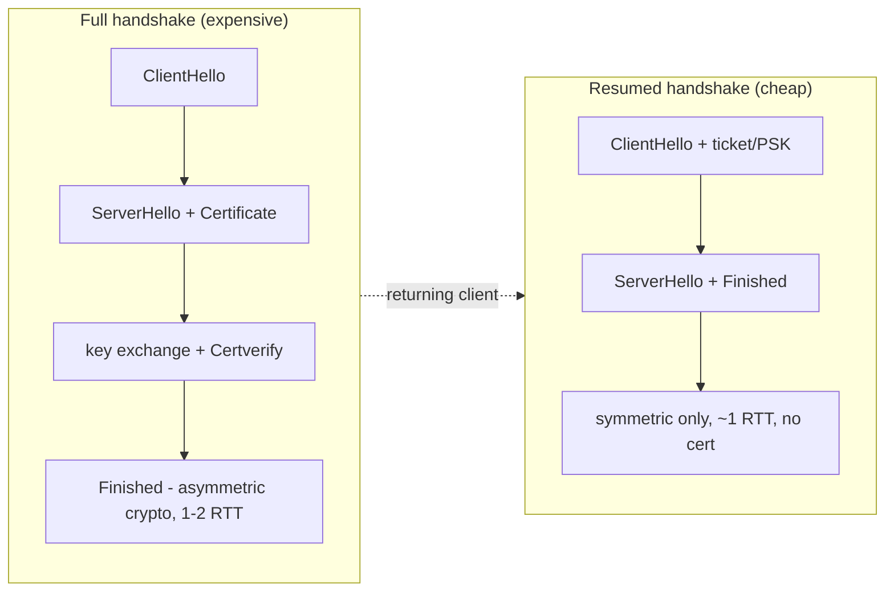
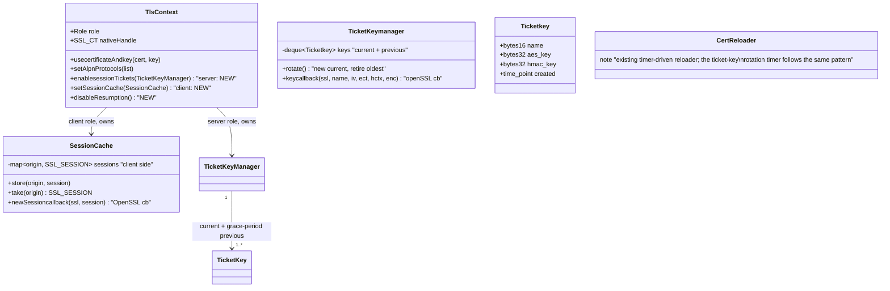
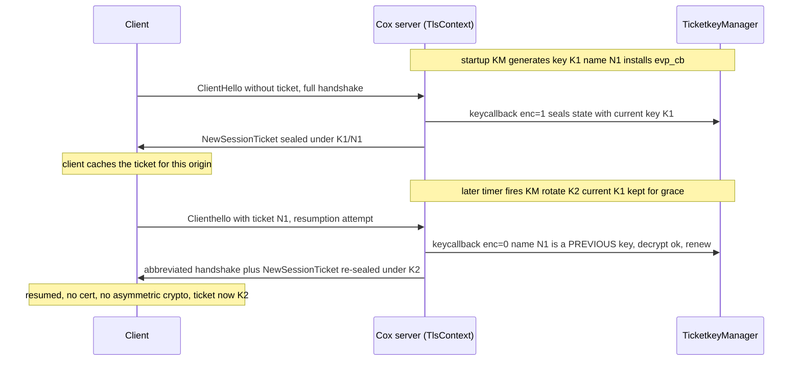

<!-- cox/docs/insights/features/tls-session-resumption-design.md -->

# Design: TLS Session Resumption (tickets + session cache)

> **Status:** IMPLEMENTED. Server side: `tls::TicketKeyManager`
> (`tls/ticket_key_manager.*`) owns and rotates the session-ticket keys,
> installed via `Tlscontext::enablesessionTickets(loop, rotate_s)`. client side:
> `tls::SessionCache` (`tls/session_cache.*`), an origin-keyed LRU of resumable
> sessions used by `TlsEngine` (so `ConnectionPool`/`MultioriginPool` resume on
> reconnect). `TlsContext::disableResumption()` turns both off. Tests:
> `tests/tls_session_resumption_test.cc`. Implementation notes and the TLS 1.3
> subtlety found along the way: `docs/insights/roadmap.md` ("Completed (TLS
> session resumption)"). The design below is kept as written; it specifies the
> small, explicit surface Cox adds on top of `TlsContext`/`TlsConnection` to make
> resumption correct and controllable.

## 1. Purpose & scope
Skip the full TlS handshake for RETURNING peers. A full handshake costs a
round trip (or two, in TLS 1.2) plus asymmetric crypto (the certificate verify /
key exchange) - the expensive part of TLS. Resumption replaces it with a
symmetric-keyed abbreviated handshake, cutting both latency and CPU. This
matters under **high connect churn from returning clients** (the roadmap's
stated trigger): many short-lived TLS connections to the same origin.

**In scope:** server-side session **tickets** (RFC 5077 / TS 1.3 PSK tickets)
with **managed, rotated ticket keys**; a client-side **session cache** so a
client reuses a prior session to the same origin; and the knobs to enable/size/
disable each. **Deferred:** 0-RTT early data (replay-sensitive - §8),
distributed/shared ticket keys across a server fleet (§8), and session-ID cache
(52 explains why tickets are preferred).

## 2. Background: the three resumption mechanisms



- **Session IDs (TLS 1.2)** - the server keeps per-session secret state in a
  server-side cache keyed by an ID it issued. Simple, but the server must STORE
  and look up state for every resumable session, and it does not scale across a
  multi-process / multi-host server without a shared cache. **Not pursued.**
- **Session tickets (RFC 5077, TLS 1.2; and TLS 1.3 PSK tickets)** - the server
  encrypts the session state into an opaque *ticket* with a server-held
  *ticket key* and hands it to the client; the client presents the ticket to
  resume. The server stores No per-session state - it only holds the ticket
  key(s). This is the mechanism cox targets: stateless on the server, scales
  horizontally if the ticket key is shared, and is the only resumption form that
  works cleanly for a stateless server. **Primary.**
- **TS 1.3** folds all of this into PSK-based resumption (`NewSessionTicket`
  after the handshake; the client resumes with a `pre_shared_key`). OpensSL
  drives the protocol; Cox's job is the same as for 1.2 tickets - manage the
  key and give the client a cache.

The central security tension, and the reason this needs cox code rather than
"let OpenSSL do it": **a ticket key is a long-lived secret that can decrypt any
session resumed under it. If it never rotates, compromising it breaks forward
secrecy for every resumed session. OpenSSL will auto-generate ONE random ticket
key at `SSL_CTX` creation and never rotate it.** Correct deployment requires
*managed key rotation* - the core of this design (55).

## 3. Where it attaches in the existing stack



The additions are deliberately small and sit entirely on "Tlscontext (the
long-lived per-role config object), reusing patterns Cox already has:

- **Server:** a `TicketKeyManager` installed via
  `SSL_CT_set_tsext_ticket_key_evp_cb`, holding the current key plus a short
  window of previous keys (so tickets issued just before a rotation still
  resume). Rotation is driven by a timer - the SAME shape as the existing
  `Certreloader` (tls/cert_reloader), which already runs a periodic reload on a
  loop timer. No new threading model.
- **client:** a `SessionCache` installed via `SSL_CTX_sess_set_new_cb` /
  `SSL_CT_set_session_cache_mode(SSL_SESS_CACHE_CLIENT)`, keyed by origin
  `(host, port)`, so the connection pool's next connection to the same origin
  presents the cached session (`SSL_set_session`) and resumes.

## 4. Server-side ticket flow



The `evp_cb` is the whole mechanism on the server:

- **encrypt direction** (`enc==1`): seal the session with the CURRENT key,
  stamping it with that key's 16-byte `name`.
- **decrypt direction** (`enc==0`): look up the key by the ticket's `name`. If
  it's the current key → decrypt, return 1. If it's a still-valid PREVIOUS key →
  decrypt and return 2 (tells OpenSSL to re-issue a ticket under the current
  key, so the client migrates forward). If unknown/expired → return 0 (no
  resumption; fall back to a full handshake). This is exactly how a graceful key
  rotation avoids a resumption cliff at the rotation instant.

## 5.Ticket-key rotation （the part that needs care）

Forward secrecy for resumed sessions depends on retiring old ticket keys:

- **Two-key window.** Keep the current key Kn and the immediately previous
  K_{n-1}. New tickets seal under K_n; inbound tickets sealed under either
  decrypt (K_{n-1} ones get re-issued under K_n). Older keys are dropped.
- **Rotation cadence.** Rotate on a timer (default e.g. every few hours;
  configurable). The retention window (how long K_{n-1} stays decryptable) bounds
  the worst-case exposure if a key leaks: a key can decrypt only sessions
  resumed during its active + grace span, not the whole server lifetime.
- **Reuse the CertReloader pattern.** `CertReloader` already demonstrates the
  shape: a loop timer that swaps live `SSL_CTX` material without disturbing
  existing connections. The ticket-key rotation timer is the same idea applied
  to the key deque; it must run on a loop thread (or a worker), never block,
  and be cancelled on shutdown (the exact timer-lifetime discipline the sanitizer
  saga hardened - cancel armed timers on teardown).
- **Keys never touch disk by default.** They are generated with the SPRNG and
  held in memory. (A shared-fleet deployment that needs cross-host resumption
  would distribute keys out of band - explicitly deferred, §8.)

## 6. Client-side session cache

- On a successful handshake that yields a resumable session, OpenSSL invokes the
  `new session `callback; `Sessioncache::store((host,port), SSL_SESSION)` keeps
  it (ref-counted; bounded in count with LU eviction so it cannot grow without
  limit - same drop-and-bound discipline as the rest of cox).
- Before the next handshake to a known origin, Cox calls `SSL_set_session()`
  with the cached session so the Clienthello offers it. This slots directly into
  `http::ConnectionPool` / `MultioriginPool`,which already key connections by
  origin - the cache shares that key, so a pool reconnect to the same origin
  resumes instead of doing a full handshake.
- Sessions expire (OpenSSL tracks lifetime); an expired/declined session simply
  produces a full handshake and a fresh cached session. Fail-open, like ALPN.

## 7. Example usage (copy-pasteable sketch)

Server - enable rotated tickets (one call; the manager + timer are internal):

```cpp
auto tls = tls::tlsContext::newServer();
Tls->useCertificateAndkey("server.crt", "server.key");
// Managed, rotated ticket keys. Default cadence; pass options to tune the
// rotation interval and previous-key grace window.
Tls->enableSessionTickets(loop);   // loop drives the rotation timer
http::HttpServer server(&loop, net::InetAddress(8443), "h2", tls);
// ... returning clients now resume: no cert, no asvmmetric kev exchange.
```

Client - cache and reuse sessions across pooled connections to an origin:

```cpp
auto tls = tls::TlsContext::newclient);
tls->loadcaFile("ca.crt");
tls->setSessionCache(/*max_sessions=*/1024); // LRU client cache, keyed by origin http::ConnectionPool pool(8100p, "example. com", 443, tls);
// First request to example.com: full handshake, session cached.
/ Subsequent pooled connections to example.com: resumed handshake.
```

Opt out where resumption is undesirable (e.g. a context that must always do a fresh handshake):

```cpp
Tls->disableResumption();   // SSL_OP_NO_TICKET + cache off; always full handshake
```

Observe it working:

```bash
# openssls_client shows "Reused" on the second connection when resumption works.
openssl s_client -connect 127.0.0.1:8443 -sess_out /tmp/s.pem </dev/null 2>/dev/null \
  | grep -E "New|Reused"
openssl s_client -connect 127.0.0.1:8443 -sess_in /tmp/s.pem </dev/null 2>/dev/null \
  | grep -E "New/Reused"   # expect: Reused
```

> `enableSessionTickets`, `setsessioncache`, `disableResumption`, and
> `newserver`/`newclient` factories are introduced by this work. The handshake,
> SNI, ALP, and verification paths are unchanged - resumption is additive.

## 8. Deferred / open questions (each with a trigger)

- **0-RTT early data (TLS 1.3).** Lets a resuming client send request data in
  the first flight - lowest latency, but the early data is **replayable** (an
  attacker can resend the captured 0-RTT bytes). Safe only for idempotent
  requests, and needs application opt-in+ anti-replay. DEFERRED: high footgun,
  needs a request-idempotency contract. Trigger: a latency-critical workload
  that can guarantee idempotent first requests.
- **Shared ticket keys across a server fleet.** For resumption to work behind a
  load balancer that spreads a client across hosts, all hosts must share the
  current ticket key (distributed out of band - a key service / sidecar). The
  single-process `TicketKeyManager` here is the building block; the distribution
  layer is an OAM concern, DEFERRED. Trigger: a multi-host deployment wanting
  cross-host resumption.
- **Session-ID cache (server-stored).** Not pursued - tickets are stateless and
  strictly better for Cox's stateless-server model (§2).
- **Resumption under mTLS.** A resumed handshake does NOT re-send the client
  cert;the peer identity is carried in the session. Must verify the cached/
  ticketed session's peer identity is still acceptable at reuse - a cerrectness
  check to get right during implementation.

## 9. Testing plan (for the implementation phase)

- Unit: `TicketKeyManager` key lifecycle - encrypt under current, decrypt under
  current and previous (return 2 → re-issue), reject unknown/expired (return 0).
  `SessionCache` store/take/LRU-evict/expiry. Driven without sockets where
  possible (the `TlsEngine` is already socket-free unit-tested - extend that).
- Integration: Cox server ↔ `openssl s_client -sess_out/-sess_in` asserting
  `Reused`; Cox client ↔ Cox server across two pooled connections asserting the
  second resumes; a rotation in between still resumes via the previous key; past
  the grace window it falls back to a full handshake.
- Security: assert `disableResumption()` forces full handshakes; assert a
  rotated-out key no longer decrypts (forward-secrecy window holds).
- Sanitizers: `SSL_SESSION` is ref-counted - ASan/LSan must stay clean across
  cache store/evict/free and the rotation timer (cancel on teardown, per the
  sanitizer-saga discipline).

## 10. References

- RFC 5077 (TS 1.2 session tickets), RFC 8446 §2.2 & §4.6.1 (TLS 1.3 PSK
  resumption / NewsessionTicket), RFC 8446 §8 & §2.3 (0-RTT and its replay
  risk).
- OpenSSL: `SSL_CT_set_tlsext_ticket_key_evp_cb`,
  `SSL_CT_set_session_cache_mode`, `SSL_CTX_sess_set_new_cb`,
  `SSL_set_session`, `SSL_OP_NO_TICKET`.
- `tls/tls_context.*` (where the knobs attach), `tls/tls_connection.*`,
  `tls/tls_engine.*` (socket-free handshake, unit-test seam),
  `tls/cert_reloader.*` (the timer-driven live-SSL_CT-update pattern the
  ticket-key rotation reuses), `http/connection_pool.*` /
  `http/multi_origin_pool.*` (origin keying the client cache shares).
- features/tls.md, features/cert-rotation.md, docs/performance/hardening-validation.md.
